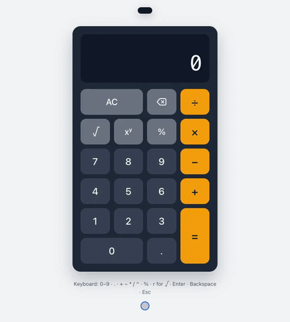

# Calculator

A full-stack calculator: a React + TypeScript frontend that sends every operation to a Go REST API, built with the standard library only. The frontend does no math.



The demo shows basic arithmetic, left-to-right chaining, floating-point display, √ / % / power, keyboard input, the loading state with AC cancelling (network delay simulated), division-by-zero handling and the mobile layout. [Higher-quality MP4](docs/demo.mp4).

**Operations:** add, subtract, multiply, divide, power, square root and percent.

## Quick start (Docker)

```bash
docker compose up --build
```

Open http://localhost:8080. To use another port:

```bash
APP_PORT=8090 docker compose up --build
```

nginx serves the built frontend and proxies `/api` to the backend. The backend has no host port.

## Running locally

Prerequisites: Go 1.27+, Node 24 LTS (see `frontend/.nvmrc`). Optional: `golangci-lint` v2.

Backend (listens on `:8080`, override with `PORT`):

```bash
cd backend && go run .
```

Frontend (http://localhost:5173, proxies `/api` to `localhost:8080`):

```bash
cd frontend && npm ci && npm run dev
```

## API

### `POST /api/v1/calculate`

Request body:

| Field       | Type   | Notes                                                                  |
| ----------- | ------ | ---------------------------------------------------------------------- |
| `operation` | string | `add`, `subtract`, `multiply`, `divide`, `power`, `sqrt`, `percent`    |
| `a`         | number | Required                                                               |
| `b`         | number | Required for binary operations; must be omitted for `sqrt` and `percent` |

`percent` is unary: `x%` = `x / 100`. A success returns `200` with `{"result": <number>}`.

```bash
curl -s -X POST localhost:8080/api/v1/calculate -H 'Content-Type: application/json' -d '{"operation":"divide","a":10,"b":4}'
```

```json
{ "result": 2.5 }
```

```bash
curl -s -X POST localhost:8080/api/v1/calculate -H 'Content-Type: application/json' -d '{"operation":"sqrt","a":81}'
```

```json
{ "result": 9 }
```

### Errors

Every error has the same shape and an appropriate status code:

```bash
curl -s -X POST localhost:8080/api/v1/calculate -H 'Content-Type: application/json' -d '{"operation":"divide","a":1,"b":0}'
```

```json
{ "error": { "code": "division_by_zero", "message": "cannot divide by zero" } }
```

| Status | Codes                                                                                                        |
| ------ | ------------------------------------------------------------------------------------------------------------ |
| 400    | `invalid_json`, `invalid_field`, `unknown_field`, `missing_field`, `unexpected_operand`, `unknown_operation` |
| 404    | `not_found`                                                                                                  |
| 405    | `method_not_allowed` (with an `Allow` header)                                                                |
| 413    | `request_too_large` (body limit: 4 KB)                                                                       |
| 415    | `unsupported_media_type` (`Content-Type` must be `application/json`)                                         |
| 422    | `division_by_zero`, `invalid_domain` (e.g. `sqrt(-1)`), `result_out_of_range` (±Inf)                         |
| 500    | `internal_error` (also returned for recovered panics)                                                        |

400 means the request is malformed; 422 means the request is valid but the math is undefined. Messages are written by the API layer: internal Go error text, type names and stack traces never reach clients (unexpected errors are logged server-side only).

### `GET /healthz`

Returns `{"status":"ok"}`.

## Tests and coverage

| Layer    | Command                                       | Coverage                                       |
| -------- | --------------------------------------------- | ---------------------------------------------- |
| Backend  | `cd backend && go test -race -cover ./...`    | `calculator` 100%, `httpapi` 97.5%             |
| Frontend | `cd frontend && npm run coverage`             | 141 tests, 100% lines, 97.7% branches          |

HTML reports:

```bash
cd backend && go test -coverprofile=coverage.out ./... && go tool cover -html=coverage.out
```

```bash
cd frontend && npm run coverage && open coverage/index.html
```

Linting and formatting: `golangci-lint run` and `gofmt -l .` in `backend/`; `npm run lint`, `npm run format:check` and `npm run typecheck` in `frontend/`.

**CI** (GitHub Actions, on every PR and push to `main`):
- **Backend:** gofmt, golangci-lint, tests with the race detector, coverage summary.
- **Frontend:** ESLint, Prettier, `tsc`, Vitest coverage, build.
- **Docker:** builds both images, then smoke-tests the page and the API through nginx.

Both coverage reports are uploaded as artifacts.

## Project structure

```
backend/
  main.go                  server setup, timeouts, graceful shutdown
  internal/calculator/     pure math, sentinel errors (no HTTP)
  internal/httpapi/        handlers, JSON errors, routing, request logging
frontend/
  src/api/                 typed client for the backend
  src/state/               pure reducer and selectors for the calculator
  src/hooks/               useCalculator (API calls, aborts), useKeyboard
  src/components/          Calculator, Display, Keypad, Key, ErrorMessage (+ CSS Modules)
  nginx.conf               static files + /api proxy
docker-compose.yml
```

## Design decisions

**Backend**
- **Standard library only.** The Go 1.22+ `ServeMux` handles method + path routing (`POST /api/v1/calculate`).
- **Layers:** the math lives in `calculator`, which knows nothing about HTTP. `httpapi` decodes and validates the request, calls `calculator`, and maps its sentinel errors to statuses and codes with `errors.Is`.
- **One endpoint with an `operation` field** instead of one route per operation. Unary and binary operations share one schema, and the frontend needs only one client function.
- **Strict input handling:**
  - Pointer fields tell "missing" apart from `0`.
  - Unknown fields and trailing data are rejected.
  - The body is limited to 4 KB with `http.MaxBytesReader`.
  - `Content-Type` is checked.
- **Floats:** values are `float64`. A result of ±Inf or NaN becomes a 422 error (JSON can't encode them anyway). `0^negative` counts as division by zero, and `-0` is normalized to `0`.
- **Operations:** server timeouts, graceful shutdown on SIGTERM, and structured JSON logs with `log/slog`.

**Frontend**
- **No math in the browser.** Each binary operation, √ and % is one API call. The frontend only formats results for display (12 significant digits) and keeps the full-precision value for the next operation.
- **Layers:**
  - A pure reducer in `state/` holds the input logic.
  - `useCalculator` adds the API calls, the loading state and request cancellation (`AbortController`; AC cancels, and late responses are ignored).
  - `useKeyboard` maps physical keys.
  - Components only render props.
- **Accessibility:**
  - Every key is a real `<button>` with an accessible name, and the pending operator uses `aria-pressed`.
  - The result is announced through `<output aria-live>`, and errors through `role="alert"`.
  - Keys show visible focus rings, and the spinner respects reduced-motion settings.
- **Styling:** CSS Modules per component, with a small token and reset file. Phones (≤ 480px) get a full-screen layout.
- **Tooling:** strict TypeScript and `typescript-eslint` strict type-checked rules. TypeScript is pinned to 6.0 because `typescript-eslint` doesn't support 7.x yet.

**Infrastructure**
- **Multi-stage images:** the Go binary runs on `distroless/static` as non-root (about 15 MB). The frontend is a static build served by `nginx:alpine`.
- **Same origin:** nginx (or the Vite proxy in dev) serves the UI and the API from one origin, so there's no CORS configuration.
- **Large headers:** nginx accepts large `Cookie` headers. Browsers share cookies across all `localhost` ports, which can exceed nginx's default 8 KB limit.

## Assumptions

- **Percentage** is unary (`50%` → `0.5`). There's no contextual "a + b%" behaviour.
- **Execution model:** classic immediate execution. Chained operations evaluate left to right (`2 + 3 × 4` = 20), like a pocket calculator.
- **Input:** up to 12 digits per number. A second `=` after a result does nothing. After an error, the next key starts fresh. There's backspace but no ± key.
- **Precision:** IEEE-754 `float64`, so `0.1 + 0.2` is `0.30000000000000004` in the API and is displayed as `0.3`.

## AI usage

The project was built with Claude Code. Every prompt is listed in [PROMPTS.md](PROMPTS.md).
